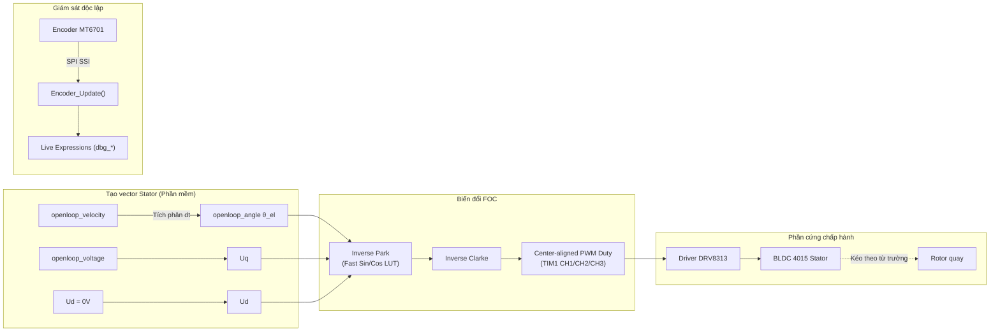

# BÁO CÁO KỸ THUẬT: CƠ CHẾ ĐIỀU KHIỂN OPEN-LOOP TRONG FIRMWARE TEST FOC

> **Dự án**: PUMA Robot - Module BLDC 4015 Controller  
> **Phần cứng**: STM32G474 + SimpleFOC Mini v2 (DRV8313) + Encoder MT6701 (SSI)  
> **Tài liệu mã nguồn**: `Robot-6-DOF/test_foc`  

---

## 1. Giới thiệu tổng quan

Trong firmware kiểm thử FOC ([test_foc](file:///d:/PUMA_ROBOT/Robot-6-DOF/test_foc)), chế độ **Open-Loop** (`FOC_MODE_OPENLOOP`) được thiết kế nhằm mục đích kiểm tra phần cứng (Hardware Bring-up / Health-check). 

Cơ chế cốt lõi của chế độ này là: **Điều khiển vector điện áp cưỡng bức không qua phản hồi cảm biến vị trí (Open-loop Voltage/Velocity Control)**, hoạt động tương tự nguyên lý vi bước (microstepping) trên động cơ bước (stepper motor).

---

## 2. Chi tiết các mắt xích cơ chế

### 2.1. Tích phân góc điện ảo (Software Angle Integration)
Khi ở chế độ `FOC_MODE_OPENLOOP`, hệ thống **hoàn toàn ngắt liên kết** giữa vị trí thực tế của rotor và góc điều khiển pha.

- **Vị trí trong mã nguồn**: [foc.c:L574-L582](file:///d:/PUMA_ROBOT/Robot-6-DOF/test_foc/Core/Src/foc.c#L574-L582)
- **Công thức cập nhật**:
  $$\theta_{el}(t) = \theta_{el}(t - \Delta t) + \omega_{el} \cdot \Delta t$$
- **Chuẩn hóa góc tuần hoàn**:
  Góc điện $\theta_{el}$ được đưa về chu kỳ $[0, 2\pi)$ qua hàm `_normalizeAngle()`:
  $$\theta_{el} = \theta_{el} \pmod{2\pi}$$

> [!NOTE]
> Tham số `openloop_velocity` là **vận tốc góc điện** (rad/s điện). Vận tốc cơ học tương ứng là $\omega_{mech} = \frac{\omega_{el}}{\text{pole\_pairs}} = \frac{\omega_{el}}{11}$.

---

### 2.2. Áp đặt vector điện áp Stator
- **$U_d = 0\text{ V}$**: Không bơm áp khử từ trục trực giao d.
- **$U_q = \text{openloop\_voltage}$**: Được chặn ngưỡng bảo vệ $\le \text{voltage\_limit}$ (mặc định trong [main.c:L85](file:///d:/PUMA_ROBOT/Robot-6-DOF/test_foc/Core/Src/main.c#L85) là `3.0V`).
- Biên độ điện áp tổng hợp:
  $$U_s = \sqrt{U_d^2 + U_q^2} = U_q = \text{const}$$
- Vector này quay tròn trong không gian Stator với tần số $\omega_{el}$, sinh ra một từ trường quay kéo nam châm rotor bám đuổi theo.

---

### 2.3. Bảng tra nhanh Sin/Cos (Lookup Table Optimization)
Thay vì sử dụng hàm toán học thư viện chuẩn `sinf()` / `cosf()` (dễ gây nghẽn chu kỳ lệnh nếu compiler thiếu cấu hình FPU hard-float), firmware xây dựng bảng tra cứu 512 phần tử với nội suy tuyến tính:

- **Khởi tạo**: Mảng `_sin_table[512]` được khởi tạo 1 lần trong [_SinCos_Init()](file:///d:/PUMA_ROBOT/Robot-6-DOF/test_foc/Core/Src/foc.c#L45-L53).
- **Truy xuất nội suy**: [_fast_sin()](file:///d:/PUMA_ROBOT/Robot-6-DOF/test_foc/Core/Src/foc.c#L59-L75) sử dụng `floorf()` để xử lý chuẩn xác cả góc âm lẫn dương:
  $$y = y_0 + \text{frac} \cdot (y_1 - y_0)$$
- **Thời gian thực thi**: Cố định xấp xỉ **~0.5 µs**, đảm bảo chu kỳ ngắt điều khiển 1 kHz (1 ms) luôn đúng hạn.

---

### 2.4. Biến đổi ngược Inverse Park & Inverse Clarke
Hàm [_FOC_WritePWM()](file:///d:/PUMA_ROBOT/Robot-6-DOF/test_foc/Core/Src/foc.c#L190-L218) chuyển đổi $(U_q, U_d, \theta_{el})$ sang điện áp 3 pha:

1. **Inverse Park**: Chuyển hệ quy chiếu quay $(d, q)$ sang hệ quy chiếu tĩnh hai trục $(\alpha, \beta)$:
   $$U_\alpha = \cos(\theta_{el}) \cdot U_d - \sin(\theta_{el}) \cdot U_q = -\sin(\theta_{el}) \cdot U_q$$
   $$U_\beta  = \sin(\theta_{el}) \cdot U_d + \cos(\theta_{el}) \cdot U_q = \cos(\theta_{el}) \cdot U_q$$

2. **Inverse Clarke**: Chuyển $(\alpha, \beta)$ sang 3 pha $(a, b, c)$:
   $$U_a = U_\alpha$$
   $$U_b = \frac{-U_\alpha + \sqrt{3} U_\beta}{2}$$
   $$U_c = \frac{-U_\alpha - \sqrt{3} U_\beta}{2}$$

---

### 2.5. Tạo xung PWM 3 pha (Center-aligned Modulation)
Driver SimpleFOC Mini v2 (DRV8313) nhận 3 tín hiệu PWM tương ứng cho 3 nửa cầu H:

$$\text{duty}_a = \frac{U_a}{V_{supply}} + 0.5$$
$$\text{duty}_b = \frac{U_b}{V_{supply}} + 0.5$$
$$\text{duty}_c = \frac{U_c}{V_{supply}} + 0.5$$

- Mức duty cycle được bão hòa an toàn trong $[0.0, 1.0]$.
- Nạp trực tiếp vào các thanh ghi so sánh của Timer 1:
  - `TIM1->CCR1 = (uint32_t)(duty_a * TIM1_ARR)`
  - `TIM1->CCR2 = (uint32_t)(duty_b * TIM1_ARR)`
  - `TIM1->CCR3 = (uint32_t)(duty_c * TIM1_ARR)`
  (với `TIM1_ARR = 3999`).

---

## 3. Bảng so sánh Open-Loop vs Closed-Loop trong Code

| Tiêu chí | Chế độ Open-Loop (`FOC_MODE_OPENLOOP`) | Chế độ Closed-Loop (`FOC_MODE_VELOCITY` / `TORQUE`) |
| :--- | :--- | :--- |
| **Góc pha điều khiển $\theta$** | $\theta_{el}$ ảo tăng dần theo thời gian | $\theta_{el}$ thực đo từ Encoder MT6701 qua SSI |
| **Cần Calibrate trước?** | **Không cần** (bỏ qua bước tìm Zero Offset) | **Bắt buộc** (phải chạy `FOC_Calibrate` thành công) |
| **Điều khiển dòng/áp** | Áp $U_q$ hằng số cố định | $U_q$ do bộ điều khiển PID van tốc tự động tính toán |
| **Khả năng giữ đồng bộ** | Có thể bị trượt bước (stall) nếu tải vượt quá lực từ | Tự động tăng mô-men khi gặp tải, không trượt bước |
| **Vai trò của Encoder** | Chỉ đọc hiển thị giám sát (`dbg_*`), không tham gia vòng lặp điều khiển | Đóng vai trò sống còn để định hướng trường từ trường |

---

## 4. Ý nghĩa thực tiễn & Hướng dẫn sử dụng

> [!TIP]
> **Khi nào nên dùng Open-Loop?**
> 1. Khi mới hàn mạch hoặc đấu nối dây motor: Kiểm tra xem 3 pha U-V-W có kết nối tốt không.
> 2. Đánh giá sơ bộ xem driver DRV8313 và nguồn 12V có cấp đủ năng lượng không.
> 3. Kiểm tra encoder MT6701: Cho động cơ quay Open-loop với tốc độ ổn định rồi quan sát `dbg_velocity` và `dbg_raw_angle` trên CubeIDE Live Expressions để xác nhận encoder đọc trơn tru, không bị nhiễu SPI hay mất xung.

> [!WARNING]
> **Lưu ý khi chạy Open-Loop**:
> - Vì không có phản hồi dòng điện và góc, động cơ tiêu tán công suất lớn nhất ngay cả khi đứng yên. Không nên đặt `cmd_openloop_voltage` quá cao ($> 3.5\text{V}$) trong thời gian dài để tránh làm nóng cuộn dây động cơ 4015 và chip DRV8313.
